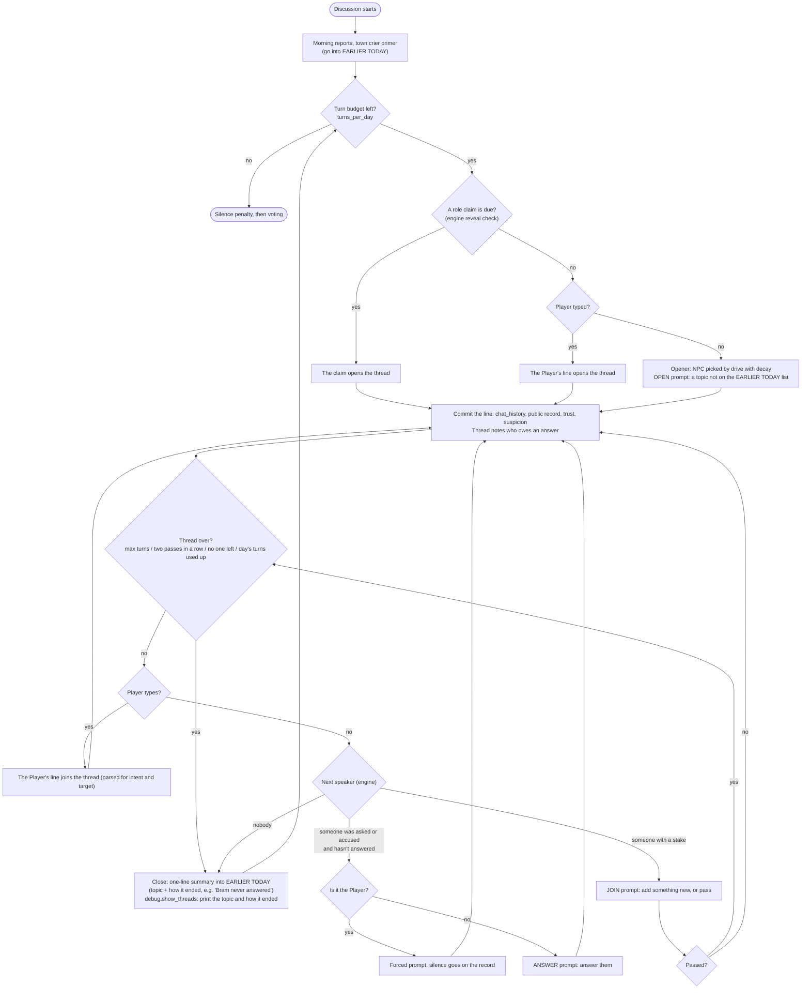

# Plan: discussion threads

> **Revised:** the day is now a single conversation about the killing. See [Revision: one conversation a day](#revision-one-conversation-a-day-2026-09-25) at the end; the multi-thread design below is kept for the record.

Replaces the assertion → reaction chain in the discussion phase with **threads**: one topic at a time,
with the engine deciding who holds the floor. Current flow: [`game-loop.md`](game-loop.md#discussion-loop-current-implementation).

## Why

From a 3-day probe game (seed 73) and the code:

| Problem | Cause | Seen as |
|---|---|---|
| Assertions turn into reactions to reactions | Reactions never reach `chat_history`, only the public record. The next speaker sees 8 old assertions and a separate record, never the exchange in order, so it picks up the liveliest recent line. | Maeve's assertion 2 repeats her denial from the reactions to assertion 1. |
| Questions go unanswered | `calculate_bids` picks the next speaker at random; nothing tracks who was asked. | Garrick asks Bram "which of us lit it?"; Bram never gets the floor. "Tell us plain" appears ~15 times. |
| Reactions go off-topic | Each reactor gets the whole day as context, with older threads right above the line it should answer. | Maeve → Bram about Garrick's stairs; Elias opens a new topic inside a reaction. |
| Pile-ons | The repeat guard only compares a speaker with their own lines. | Victor, Bram and Maeve each ask "what did your own eyes see?" in a row. |

## The model

A day's discussion is a series of threads, **one at a time**. A **thread** is one topic, opened by one line,
answered and argued over for a few turns, then closed before the next one opens. The engine keeps the thread's state
and picks every speaker; the LLM only decides what that speaker says (or that they pass). A closed thread lives on as
one line in EARLIER TODAY, so a later opener can return to it, but only as a new thread.



### Thread state (`models/thread.py`, new)

```python
@dataclass
class Turn:
    speaker: str
    intent: str            # the same intents as today, plus "reveal_role" and "pass"
    target: str
    dialogue: str

@dataclass
class Thread:
    day: int
    opener: str
    topic: str             # a few words, from the opener's JSON ("the wax at the mill gate")
    turns: list[Turn]
    owed: str | None       # who was asked or accused and hasn't spoken since
    passes_in_a_row: int
    ended: str             # "", "budget", "passes", "no one left"
```

`GameState.threads` holds `{day: [Thread]}`. `Thread.render()` gives the full exchange for prompts;
`Thread.summary()` gives the one-liner for EARLIER TODAY, with the outcome added by the engine
("Bram never answered", "Maeve denied it").

### Who speaks next (`core/discussion_director.py`, new, no LLM)

1. **Owed an answer:** the target of the last `question` or `accuse` in the thread, if they haven't spoken since.
   If that's the Player, the forced prompt runs (silence goes on the record, as today).
2. **A stake in the thread:** friends and packmates of whoever was just targeted (stake 2), then anyone who knows
   the last speaker or target (stake 1), reusing the allegiance logic of today's `build_reaction_queue`. Weighted by
   stake × `assertion_drive`. The last speaker is excluded, and nobody takes more than
   `max_turns_per_speaker` turns in a thread unless they're answering.
3. **A bystander,** with `bystander_chance`, if nobody has a stake.
4. **Nobody:** the thread closes.

A thread also closes after `max_turns_per_thread` turns, after two passes in a row, or when the day's
`turns_per_day` run out (the vote then follows, as today).

Openers are picked as today (`assertion_drive` with decay), with a boost for anyone accused today who hasn't
spoken since.

### Prompts: one context, three roles (`services/prompt_service.py`)

Every discussion turn gets the same context, and much less of it than today:

- SITUATION, WHO IS HERE, ROLE CLAIMS, WHAT CONCERNS YOU (unchanged)
- **EARLIER TODAY:** morning reports, claims, and one line per closed thread
- **THIS CONVERSATION:** the current thread, in full and in order

Today's public record and the 8-line chat window are dropped from discussion turns, because EARLIER TODAY replaces
them. Votes, logbooks and the aftermath keep using the record as they do now.

The instruction depends on the role:

| Role | Instruction (gist) | Output |
|---|---|---|
| OPEN | Raise something not on the EARLIER TODAY list (evidence, a claim, a vote, someone's behavior), or return to a topic only with something new. | decision JSON plus `topic` |
| ANSWER | *X just asked or accused you: "…".* Answer it: explain, deny, or turn it around. At most one question back. | decision JSON |
| JOIN | Add something new to **this** exchange: back someone, challenge them, or ask the one thing nobody asked. Otherwise pass. | decision JSON, `pass` allowed |

`FACTS_ONLY`, day guidance and the logbook stay as they are. `build_assertion_prompt` and `build_reaction_prompt`
are replaced by `build_turn_prompt(role, …)`.

### Guards

- **Repeat guard across speakers:** a line that closely repeats *anyone's* line in this thread (not just the
  speaker's own) is retried once with "X already said: …". Same SequenceMatcher threshold as now.
- **Validation stays:** `_validate_decision` (intents, living targets, target recovered from the line).
- **Fallbacks:** an empty or broken answer counts as a pass (a join) or a deflection line (an answer), never a crash.

### What else changes

| Area | Change |
|---|---|
| `chat_history` | Every turn goes in, in order, so the end-of-day summary (`condense_day_history`) sees the whole day. |
| Role claims | The engine reveal check runs between threads. A claim **opens** the next thread, so the town argues about it. Counter-claims from pressure open the one after. |
| Player | At a thread boundary, typing opens a new thread. Mid-thread, typing joins it; if they ask or accuse someone, that person answers next. `player_actions_today` and the penalties are unchanged. |
| Prefetch | The engine knows the next speaker once a turn is committed, so the next turn is generated while the player reads (invalidated if the player types), like today. |
| Config (`discussion`) | New: `turns_per_day` (24), `max_turns_per_thread` (6), `max_turns_per_speaker` (2), `bystander_chance` (0.3). Removed: `max_assertions_per_day`, `max_reactions_per_assertion` (the aftermath gets its own `max_aftermath_reactions`). `decay_factor` stays for openers. |
| Config (`debug`) | New: `show_threads` (env `DEBUG_SHOW_THREADS`). Prints a muted line when a thread opens (`— thread 2: the wax at the mill gate —`) and when it closes (`— closed: Bram never answered —`). Off by default. |
| Length and cost | **A day stays as long as today.** The budget counts turns, not threads: `turns_per_day` 24 matches today's ceiling of 6 assertions × (1 + 3 reactions). Threads end early on passes, so a day usually holds 4–6 of them. Passes cost a call but show nothing, as silent reactions do now. |

## Milestones

Each milestone leaves the game playable and is tested offline (FakeLLM) and then in one live probe game.

**T1: Thread model and a chronological transcript (small)**
- `models/thread.py`, `GameState.threads`, render and summary.
- Every discussion line (assertions and reactions, still the old flow) goes into `chat_history` in order.
- Tests: rendering, summaries, chronological history.

**T2: The director (medium)**
- `core/discussion_director.py`: next speaker, closing rules (including the day's turn budget), opener choice.
- Pure engine, no LLM: fully covered by tests (the owed answer comes first, two passes close the thread,
  per-speaker cap, the Player owes an answer, nobody left).

**T3: Turn prompts and guards (medium)**
- `build_turn_prompt(role, …)` with EARLIER TODAY and THIS CONVERSATION; `topic` in the opener's JSON; `pass`.
- `NPCController.take_turn(name, role, thread)` replaces `generate_assertion` and `process_reaction`.
- Repeat guard across speakers.
- Tests: each role's prompt carries the right parts, pass handling, cross-speaker retry.

**T4: The new discussion phase (large)**
- Rewrite `DiscussionPhase.run` around threads: openers, turns, Player joins and forced answers, claims as
  openers, prefetch.
- `io_handler`: prompts reworded ("type to start a new topic" / "type to join in"); `debug.show_threads` markers.
- `player_controller.get_status` shows threads instead of assertion slots.
- Tests: an end-to-end day with FakeLLM (a question gets answered next, a claim opens a thread, the Player's
  question makes the target answer, the budget ends the day).

**T5: Measure and tune (medium)**
- Probe metrics, computed by the engine from the threads: unanswered questions, turns per thread, passes, and
  near-repeats across speakers. The judge also gets a per-thread "off-topic turns" check.
- Run the same seeds as the last batch (71–73, `--spare-player`) before and after, and tune the per-thread limits.
  Lines per day must stay close to the baseline.
- **Gate:** the model counts as validated only if unanswered questions, cross-speaker repeats and off-topic turns all
  drop against the baseline. Only then do the deferred features (below) get planned.

**T6: Cleanup and docs (small)**
- Remove `build_reaction_queue`, `calculate_bids` (folded into the director), the old prompts and config keys;
  update `headless.py` and `probe.py` flags (`--threads` replaces `--max-assertions`).
- Replace the discussion diagram in `game-loop.md`; add the decisions to `implementation-plan.md`.

Order: T1 → T2 → T3 → T4 → T5 → T6. T1–T3 don't change what the player sees; T4 switches the flow over.

## Risks

| Risk | Mitigation |
|---|---|
| A silent Player makes every thread end on the forced prompt | The Player is owed an answer only when asked or accused directly, and once per thread. After that the thread moves on. |
| One topic eats the day (everyone piles on the stranger) | Turn cap per thread; openers see EARLIER TODAY and are told to raise something new; a boost for anyone accused who hasn't spoken. |
| Threads feel mechanical, all the same length | Passes end threads early; the bystander chance adds the odd voice; budgets are tunable in config. |
| Less context means characters forget earlier topics | The EARLIER TODAY summaries carry each topic and how it ended; logbooks and concerns are unchanged. |
| Openers still riff on the last thread | The OPEN prompt names the closed topics explicitly; the probe's per-thread check measures it in T5. |

## Decisions (2026-09-25)

| # | Decision |
|---|---|
| 1 | Threads run **one at a time**. A closed thread stays in EARLIER TODAY as one line. |
| 2 | **A day keeps its current length:** the budget is `turns_per_day` (24, today's ceiling), not a thread count. |
| 3 | **Validate the model first** (T5 gate). Changing topic mid-thread (e.g. `/new`) is deferred until then. |
| 4 | Thread markers (topic and outcome) are a **debug flag**, `debug.show_threads`, off by default. |

## Results (2026-09-25)

All milestones are implemented. Measured with `scripts/probe.py --metrics` on live games (DeepSeek v4.1 flash,
`--spare-player` so games run 2-4 days), the old flow on seeds 71, 72 and 74 (8 days), threads on seeds 71-74
(10 days). The same LLM judge labels every line of both.

| Metric | Assertions + reactions | Threads |
|---|---|---|
| Spoken lines per day | 18.9 | 19.1 |
| Questions to a villager left unanswered (not answered within 3 lines) | 32% | **6%** |
| Pile-ons: repeating someone's demand without adding anything (judge) | 29% | **8%** |
| New rounds that only keep the last exchange going (judge) | 57% | **33%** |
| Replies that wander off to another subject (judge) | 7.2% | **4.5%** |
| Non sequiturs (judge) | 0% | 1.6% (3 lines; see below) |
| The Player's direct questions answered by that villager next | n/a | **17 of 18** |

The gate passes. Of the three non sequiturs, one was a real bug (an empty opening printed as
"... (Glares in silence)"; an opener with nothing to say now hands the floor to someone else) and two were
villagers answering a line from a little earlier. The judge's noise between two runs over the same games was
about ±5 points.

Found and fixed during validation:

- A question on a thread's last allowed line closed the thread before the answer. The owed answer now gets one
  turn of overtime.
- The next opener was prefetched before the closed thread's summary reached EARLIER TODAY, so it didn't know
  what had just been discussed. The summary is added first, and the OPEN prompt names the topic that just closed.
- Thread summaries carry topics, not what was said, so a villager who denied something in one thread gave in
  when it came up again in a later one. Every turn now shows the speaker their own lines from earlier today.
- The provider (OpenCode) returns short bursts of `HTTP 400 server_error` ("Upstream request failed"). The client
  now retries server-side failures twice (1s, 4s); in-game errors went from up to 12 per game to none.

Still open, for after this change settles: changing topic mid-thread (`/new`, decision 3), and the characters'
fondness for "plain" / "plainly" (a third of all lines, in both flows; it's their voice, not the flow).

## Revision: one conversation a day (2026-09-25)

Playing the multi-thread version still felt scattered: a day hopped between four or five topics. The day is now
**one conversation about the killing** (decision 22):

- **Today's question** leads every turn prompt: who killed the victim, where they were found and the traces
  beside the body, or after a quiet night, who was spared and why. The morning reports are part of it.
- **JUST SAID:** the last two lines, verbatim, with "respond to this". Older lines of the day come compacted
  (the last 10, trimmed), for reference only. Every line must be about today's question.
- **Roles:** ANSWER (whoever was asked or accused), JOIN (someone with a stake in the last two lines; may pass),
  and LEAD: the first line of the day, or, after two passes or when nobody has a stake, a new angle *of the
  killing* that links to what was just said. There are no topic switches, and no turn cap per topic.
- Nobody speaks more than 2 of the last 6 lines (answers excepted): `speaker_window` and `max_in_window` replace
  the per-thread caps. Role claims are spoken into the conversation (checked every 4 lines).
- `debug.show_threads` shows the day's question and marks each new angle.

Measured on live games (seeds 71-74, `--spare-player`), with the judge also rating each day as a whole:
structure 1-5 (5 = one line of inquiry followed through), and how many subjects it jumps between.

| Metric | Assertions + reactions | Threads (topics) | **One conversation** |
|---|---|---|---|
| Structure, 1-5 (judge, per day) | 4.1 | 3.2 | **3.8** |
| Subjects per day (judge) | 2.9 | 4.9 | **3.9** |
| Pile-ons (judge) | 46% | 12% | **12%** |
| Replies that wander off (judge) | 3.6% | 3.9% | **1.6%** |
| Questions and accusations answered within 2 lines (engine record) | n/a | 96% | **94%** |
| The Player's direct questions answered next | n/a | 17 of 18 | **25 of 27** |
| Spoken lines per day (villagers) | 18.9 | 19.1 | 17.6 |

The old flow's high structure score came from piling on: nearly half its lines repeated someone's demand, so a
day rarely moved at all. One conversation keeps the pile-ons down and follows one line of inquiry better than
separate topics did.
